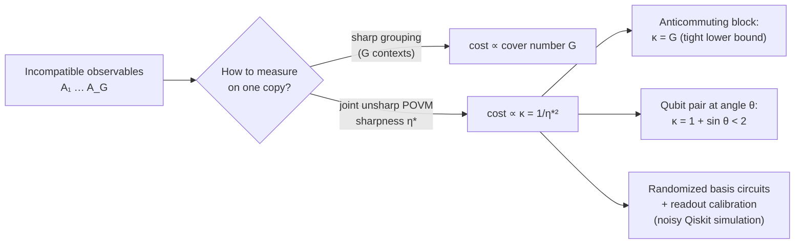
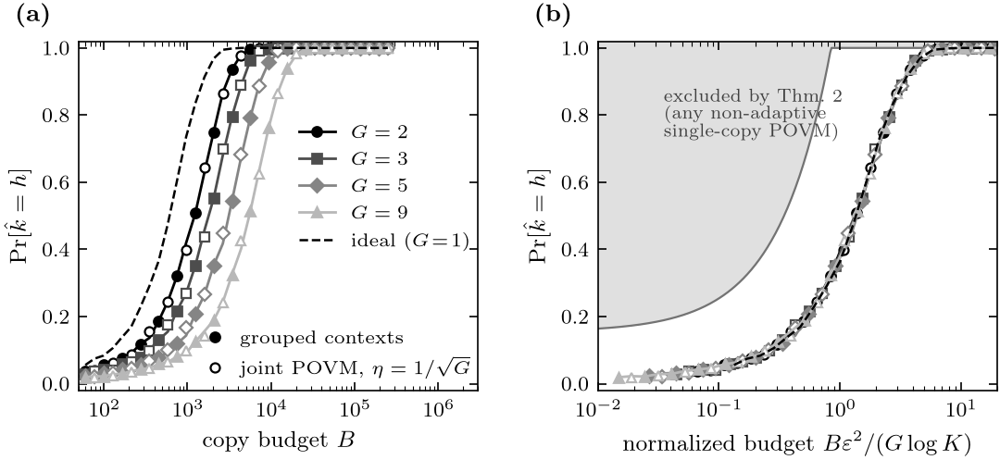
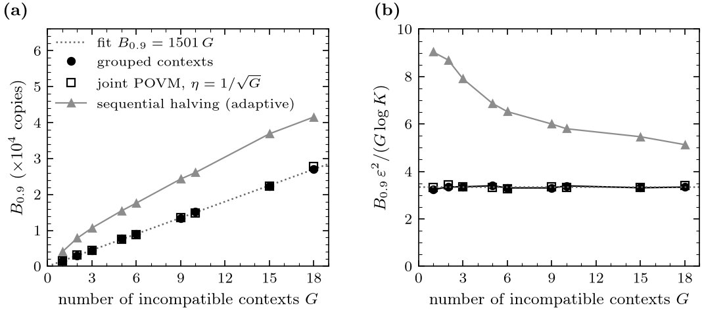
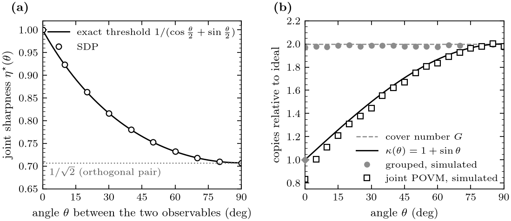
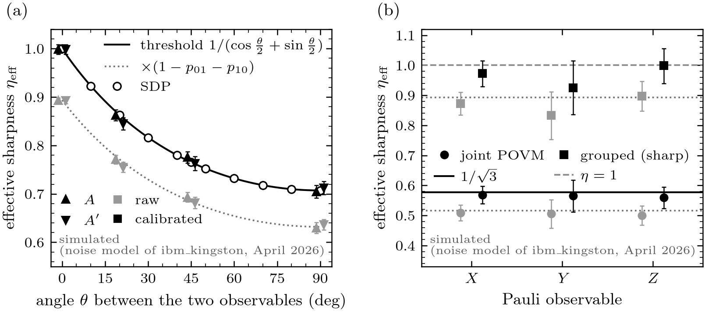

<div align="center">

# The Copy Cost of Incompatibility

### How many quantum state copies does it cost to learn from incompatible observables?

**Reproducible Python code for quantum learning theory: joint measurability, unsharp (POVM) measurements, incompatibility and sample complexity, with noisy Qiskit circuit simulations.**

[](https://www.python.org/)
[](https://www.ibm.com/quantum/qiskit)
[](https://github.com/Qiskit/qiskit-aer)
[](https://www.cvxpy.org/)
[](notebooks/)
[](tests/)
[](#reproducibility)

[Overview](#overview) •
[Results](#results) •
[Quick start](#quick-start) •
[Notebooks](#notebooks) •
[Repository layout](#repository-layout) •
[FAQ](#faq) •
[Citation](#citation)

</div>

---

## Overview

A learner that receives copies of an unknown quantum state and must evaluate many observables faces a basic
problem: **incompatible observables cannot be measured sharply on the same copy**. The classical answer is
to split the copies into groups of compatible observables (measurement contexts). The quantum alternative is
a **joint unsharp measurement** (a POVM that reads every observable with reduced sharpness η on every copy).

This repository contains the code behind the preprint *The Copy Cost of Incompatibility*, which shows that:

* the price of incompatibility is captured by an **incompatibility number κ = 1/η\*²**, where η\* is the
  joint-measurability threshold, computed here by **semidefinite programming (SDP)**;
* for **anticommuting Pauli blocks** of size G, κ = G and no single-copy strategy beats a factor G in copies:
  neither unsharp joint measurements, nor entangled measurements across blocks, nor adaptivity;
* for **weakly incompatible qubit pairs** at angle θ, the joint POVM costs κ(θ) = 1 + sin θ and **beats every
  sharp grouping** (which costs 2);
* the joint POVMs can be implemented as **randomized single-qubit basis measurements**, which are simulated
  here with the calibration-based noise model of a 156-qubit IBM Heron r2 device, including **readout-error
  calibration**.



## Results

Every table and figure of the paper that comes from a computation is regenerated by the notebooks.

<table>
<tr>
<td width="50%"></td>
<td width="50%"></td>
</tr>
<tr>
<td><b>Selection on anticommuting blocks.</b> Grouped sharp contexts and the joint POVM are indistinguishable;
all curves collapse under the normalization B ε²/(G log K).</td>
<td><b>Copies for 90% success.</b> Linear in G for both non-adaptive learners; sequential halving (adaptive) is
more expensive.</td>
</tr>
<tr>
<td></td>
<td></td>
</tr>
<tr>
<td><b>Weakly incompatible qubit pairs.</b> SDP thresholds match the closed form 1/(cos θ/2 + sin θ/2); the joint
POVM follows κ(θ) = 1 + sin θ, below the cover number 2.</td>
<td><b>Noisy circuit simulation.</b> Randomized-basis circuits realise the target sharpness; readout noise
rescales it by 1 − p₀₁ − p₁₀, and calibration removes the rescaling.</td>
</tr>
</table>

| Table | Content | Notebook | Output |
|---|---|---|---|
| Table 1 | SDP joint-measurability thresholds vs. closed forms, incompatibility numbers κ | 01 | `results/table1_sdp.tex` |
| Table 2 | Tomographic sharpness of the pair POVM, raw and calibrated (noise model, qubit 72) | 04 | `results/table2_noisysim.tex` |
| Table 3 | Effect of asymmetric readout error and of symmetric vs. full calibration | 04 | `results/table3_asym.tex` |

## Quick start

```bash
git clone https://github.com/ocatak/quantum-learning-copy-cost.git
cd quantum-learning-copy-cost
python3.12 -m venv .venv && source .venv/bin/activate
pip install -r requirements.txt
pip install -e .
jupyter lab notebooks/
```

Run all notebooks from the command line (about 2 minutes on a laptop):

```bash
cd notebooks
for nb in 0*.ipynb; do
  jupyter nbconvert --to notebook --execute --inplace --ExecutePreprocessor.timeout=-1 "$nb"
done
```

## Notebooks

| # | Notebook | What it computes | Run time |
|---|---|---|---|
| 1 | [`01_operators_and_sdp_thresholds`](notebooks/01_operators_and_sdp_thresholds.ipynb) | Machine-precision checks of the joint POVM (positivity, completeness, marginals, Born rule) for G ≤ 9; SDP thresholds η\* for anticommuting blocks and qubit pairs (**Table 1**) | < 1 min |
| 2 | [`02_anticommuting_selection`](notebooks/02_anticommuting_selection.ipynb) | Monte Carlo selection on hard instances (K = 90, ε = 0.1): grouped contexts, joint POVM, sequential halving (**Figs. 2, 3**) | ~1 min |
| 3 | [`03_qubit_pairs`](notebooks/03_qubit_pairs.ipynb) | Copies needed to estimate all correlations of 10 qubit pairs vs. angle θ (**Fig. 4**) | < 1 min |
| 4 | [`04_noisy_simulation`](notebooks/04_noisy_simulation.ipynb) | Randomized-basis circuits on Qiskit Aer with the `FakeKingston` noise model and an asymmetric readout model; marginal tomography, calibration, bootstrap intervals (**Tables 2, 3, Fig. 5**) | < 1 min |

The notebooks are committed **with their outputs**, so they can be read on GitHub without running anything.
Notebooks 2–4 have a `RECOMPUTE` flag; set it to `False` to redraw from saved results.

## Repository layout

```
quantum-learning-copy-cost/
├── notebooks/              four notebooks that regenerate all tables and figures
├── src/
│   ├── copycost/           numerics of the main text
│   │   ├── operators.py      anticommuting Pauli families (Jordan–Wigner), joint POVM checks
│   │   ├── sdp.py            joint-measurability threshold η* by semidefinite programming
│   │   ├── selection.py      hypothesis selection: grouped, joint POVM, sequential halving
│   │   ├── pairs.py          estimation with weakly incompatible qubit pairs
│   │   └── style.py          figure style
│   └── jointpovm/          randomized-basis implementation of joint POVMs (Qiskit)
│       ├── axes, schemes, states, circuits, povm    schemes, states, circuits, POVM reconstruction
│       ├── sampling, execute                        multinomial shot allocation; Aer / fake backend / IBM executors
│       ├── predictions, analysis, experiment        exact predictions, estimators, bootstrap, plan → run → analyse
│       └── sdp, figures
├── scripts/                command-line runs (simulator, fake backend, IBM hardware dry run, reports)
├── tests/                  pytest suite (operator identities, statistics, pipeline)
├── reference/              data behind the published figures and tables, for comparison
├── results/                notebook output: JSON with full metadata, LaTeX table rows
└── figures/                notebook output: PDF and PNG figures
```

## Reproducibility

* **Pinned environment.** `requirements.txt` pins every scientific package (NumPy, SciPy, CVXPY, Clarabel,
  Qiskit, Qiskit Aer, Qiskit IBM Runtime, matplotlib).
* **Fixed seeds.** Selection (20261114), qubit pairs (7), operator checks (1), shot allocation (1234),
  simulator (4321), bootstrap (99).
* **Checks against the paper.** Each notebook compares its output with `reference/`:
  * Table 1 and Tables 2–3 are reproduced exactly.
  * The qubit-pair curve matches at 18 of 19 angles.
  * The selection curves agree within Monte Carlo error.
* **Full metadata.** Every results file records package versions, seeds, transpiled circuit depth, the qubit
  used and the backend calibration values.
* **No quantum hardware needed.** `FakeKingston` runs locally on Qiskit Aer with a stored calibration snapshot of
  `ibm_kingston` (15 April 2026). Other versions of `qiskit-ibm-runtime` may ship a different snapshot.

### Command-line interface

```bash
python -m pytest -rA                                                    # test suite (~1 min)
python scripts/sdp_thresholds.py                                        # SDP thresholds → results/sdp_eta.json
python scripts/run_simulator.py                                         # noiseless Aer
python scripts/run_simulator.py --readout-p 0.0085 --readout-p10 0.098  # asymmetric readout error
python scripts/run_fake_backend.py --backend FakeKingston --qubit 72 --out results/fake_backend_q72.json
python scripts/report.py results/fake_backend_q72.json                  # compact text report
python scripts/make_figures.py --data results/fake_backend_q72.json --name fig_noisy_sim --usetex
```

`scripts/run_hardware.py` runs the same experiment on an IBM Quantum device. By default it is a **dry run**: it
transpiles the plan and prints the job summary and estimated QPU time. Jobs are submitted only with
`--submit --confirm <backend>`.

### Implementation notes

* **i.i.d. randomized POVM.** Joint schemes draw the number of copies per measurement axis from a seeded
  multinomial, so every copy follows the randomized POVM. Proportional allocation would be stratified sampling.
* **Aer seeding pitfall.** qiskit-aer's `SamplerV2` reuses one `seed_simulator` for all pubs that have
  different shot counts, which correlates their sampling errors. `AerExecutor` seeds each pub independently, and
  regression tests check this.
* **Readout symmetrization.** `NoiseModel.from_backend` uses the symmetric `readout_error` in both directions.
  Asymmetric readout (`p₀₁ ≠ p₁₀`) is therefore simulated with an explicit readout model.
* **Equal shots per pub on IBM Runtime.** Circuits are run in equal-shot chunks and truncated to their
  multinomial counts; discarded shots are recorded.

## FAQ

<details>
<summary><b>What is the incompatibility number κ?</b></summary>

For a family of ±1-valued observables, η\* is the largest sharpness at which all of them have a joint POVM with
marginals (I + η A_k)/2. The incompatibility number is κ = 1/η\*². A learner using that joint POVM pays a factor κ
in copies relative to an ideal learner that could read every observable sharply on every copy.
</details>

<details>
<summary><b>Is joint (unsharp) measurement better than grouping observables into compatible contexts?</b></summary>

It depends on the family. For pairwise anticommuting Pauli operators (G per block), κ = G equals the number of
contexts, so the two strategies cost the same, and the paper proves that nothing single-copy does better. For two
qubit observables at angle θ, κ(θ) = 1 + sin θ < 2, so the joint POVM beats sharp grouping. Notebook 3 shows this.
</details>

<details>
<summary><b>How is a joint POVM implemented on a quantum computer?</b></summary>

As a randomized single-qubit measurement: on each copy, pick a measurement axis n at random, rotate with U_n
(so that measuring Z after U_n measures n·σ), measure, and post-process the outcome into ±1 outcomes for every
observable. See `src/jointpovm/schemes.py` and notebook 4.
</details>

<details>
<summary><b>Does this repository use real quantum hardware?</b></summary>

No. All results are simulations: exact NumPy/Monte Carlo for the main text, and Qiskit Aer with a device-derived
noise model for the circuit implementation. A hardware runner is included and defaults to a dry run.
</details>

<details>
<summary><b>How are the joint-measurability thresholds computed?</b></summary>

With a semidefinite program in CVXPY (solver Clarabel): maximize η subject to a POVM {F_b} with F_b ⪰ 0, Σ F_b = I and
the required marginals. The SDP values agree with the closed forms 1/√G and 1/(cos θ/2 + sin θ/2) to solver
precision (notebook 1).
</details>

## Keywords

quantum learning theory · sample complexity · copy complexity · incompatible observables · joint measurability ·
unsharp measurement · POVM · measurement incompatibility · anticommuting Pauli operators · Jordan–Wigner ·
quantum hypothesis selection · empirical risk minimization · minimax lower bound · Fano inequality ·
semidefinite programming · shadow tomography · classical shadows · randomized measurements · readout error
mitigation · Qiskit · Qiskit Aer · IBM Quantum · noisy simulation · bootstrap confidence intervals

## Citation

If you use this code, please cite the preprint ([`CITATION.cff`](CITATION.cff) is also provided; GitHub shows a
"Cite this repository" button):

```bibtex
@misc{catak2026copycost,
  author       = {Catak, Ferhat {\"O}zgur},
  title        = {The Copy Cost of Incompatibility},
  year         = {2026},
  howpublished = {Preprint},
  note         = {Code: \url{https://github.com/ocatak/quantum-learning-copy-cost}}
}
```

## Author

**Ferhat Özgur Catak**, University of Stavanger, Norway.
Questions and issues are welcome via [GitHub Issues](https://github.com/ocatak/quantum-learning-copy-cost/issues).
